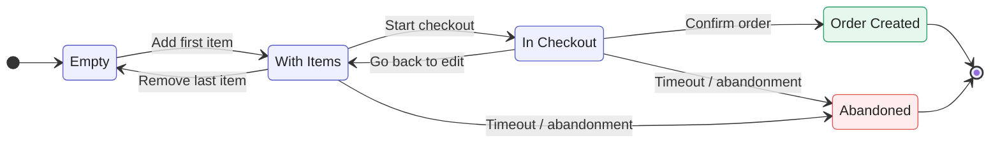
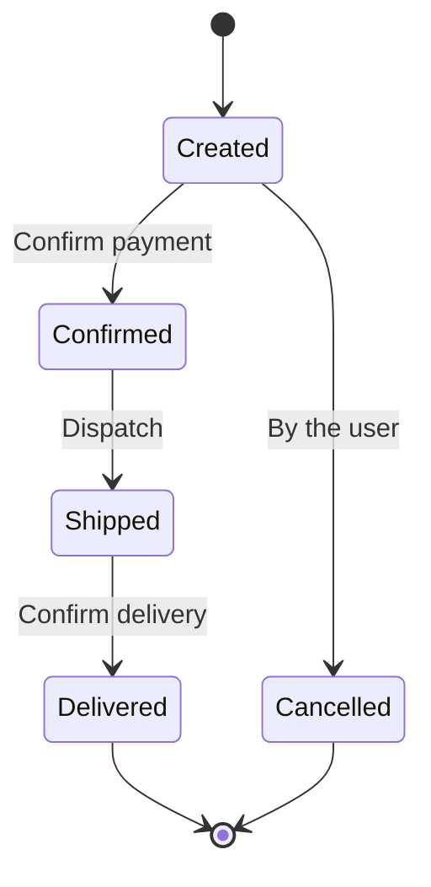

# High-Level Requirements

## System Objective
Simplified e-commerce system for educational purposes: it supports product listing, shopping cart management, discount coupon application, and order processing.

## Main Entities
| Entity | Fields | Notes |
| ---- | ---- | ---- |
| **Product** | name, description, price, stock | Listing only |
| **Shopping Cart** | items, quantities, subtotals, status | Managed by a state machine |
| **Cart Item** | product, quantity, unit price | Linked to the cart |
| **Order** | items, total, applied discount, status, coupon | Converted from the cart |
| **Order Item** | product, quantity, unit price | Linked to the order |
| **Discount Coupon** | code, type (percentage/fixed), value, expiration date | Mandatory validation |

## Main Flows
1. **Product Listing** — List products from the catalog.
2. **Cart Management** — Add item to the cart, remove item, update quantity, view cart.
3. **Coupon Application** — Validate coupon (existence, expiration) and apply discount to the cart.
4. **Cart-to-Order Conversion** — Calculate total with discount, check stock, create order, decrement
stock.
5. **Order Status Transitions** — Manage the order lifecycle according to the state diagram.

## State Diagrams
The system has two fundamental state diagrams. The first will be used as input for the AI to generate the corresponding state machines in Step 4.

## Shopping Cart State Diagram:


```
States: Empty → With Items → In Checkout → Order Created
                                         └→ Abandoned
Transitions:
- Empty → With Items            (when adding the first item)
- With Items → Empty            (when removing the last item)
- With Items → With Items       (when adding/removing items, updating quantity)
- With Items → In Checkout      (when starting checkout)
- In Checkout → With Items      (when going back to edit the cart)
- In Checkout → Order Created   (when confirming the order)
- Any state → Abandoned         (timeout or explicit user action)

Forbidden: Order Created → any other state (irreversible)
```

## Order State Diagram:


```
States: Created → Confirmed → Shipped → Delivered
        └→ Cancelled

Transitions:
- Created → Confirmed  (when payment is confirmed)
- Created → Cancelled  (by the user)
- Confirmed → Shipped  (when dispatched)
- Shipped → Delivered  (when delivery is confirmed)

Forbidden: going back to a previous state (e.g., Delivered → Confirmed)
Forbidden: cancelling after Confirmed
```

## Constraints and Out of Scope
| In Scope | Out of Scope |
| ---- | ---- |
| Product Listing | Authentication / Authorization |
| Cart with states | Real payment gateway |
| Coupons (percentage and fixed) | Notifications (email, push) |
| Orders with discount | Product image upload |
| Status transitions | Full-text search |
| Docker-compose | CI/CD pipeline |

## Intentional Gaps
The following points are intentionally left undefined. They will be resolved by the developer in **Step 1** (scaffolding brainstorming) and **Step 2** (feature brainstorming):
* **Exact discount rules:** Threshold values? Are coupons cumulative? Can a coupon be used more than once?
* **Stock behavior:** What happens if stock reaches zero during order creation? Optimistic or pessimistic decrement?
* **Data validation:** What level of input validation (only not null? Types? Ranges?)?
